# NJC AI Monitor

**English** · [简体中文](README.zh-CN.md)

A Windows 10/11 AI-agent dashboard for the Thermalright Trofeo Vision 11.3 LCD.
It renders Codex, Cursor, Claude Code, memory, market, news, and weather data as a
1920×400 five-column dashboard and sends it to the display over USB. A local preview
is available when the LCD is disconnected.

## Interface previews

### 1. No active agent

The four dynamic columns show Markets, News, AI Quota, and Forecast. The fixed system/current-weather column remains visible.

**Bitcoin Orange**\
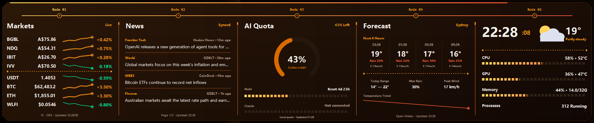\
**Web3 Emerald**\
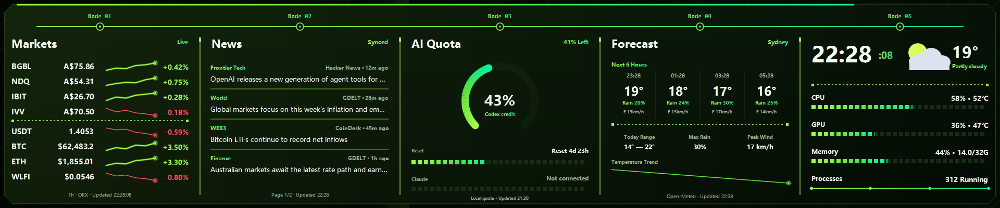\
**Graphite Titanium**\
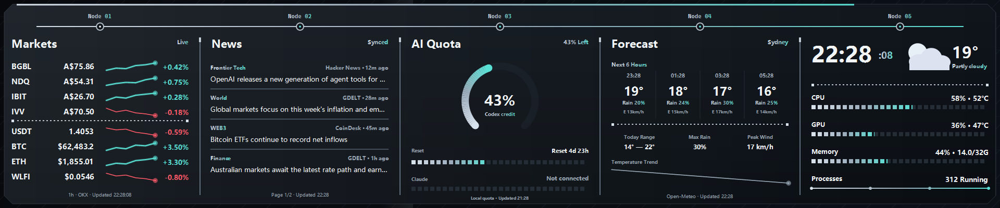\
**Cyber Neon**\
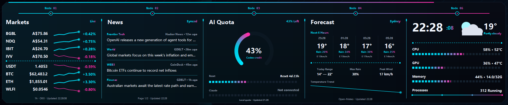\
**Solana Aurora**\
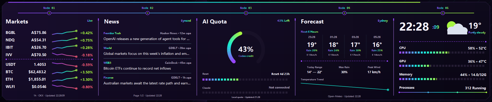

### 2. One working agent

The working session takes the first column; Markets, News, and AI Quota fill the remaining columns.

**Bitcoin Orange**\
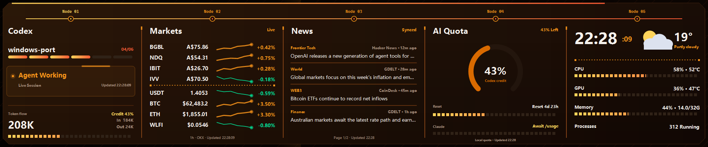\
**Web3 Emerald**\
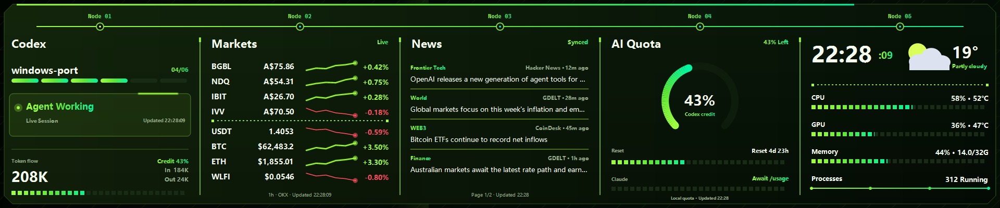\
**Graphite Titanium**\
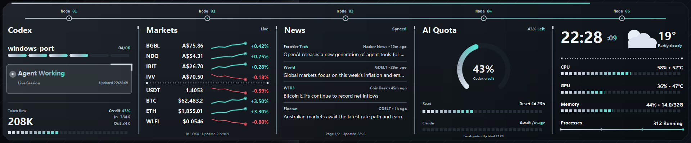\
**Cyber Neon**\
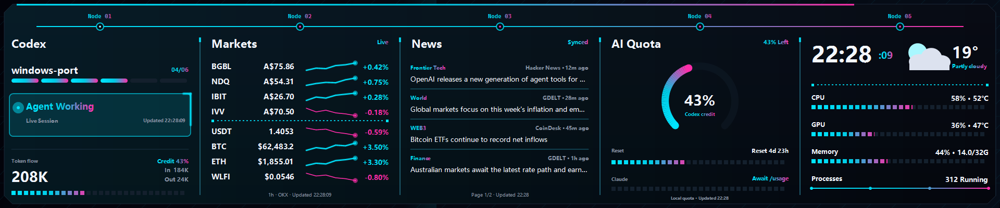\
**Solana Aurora**\
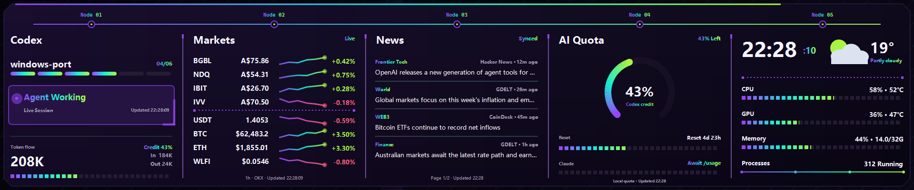

### 3. Two agents: working and just completed

The first column shows `Agent Working`, while the second shows `Task Completed` with its persistent attention border. Markets and News occupy the other two columns.

**Bitcoin Orange**\
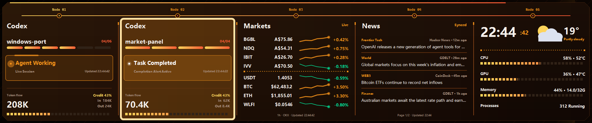\
**Web3 Emerald**\
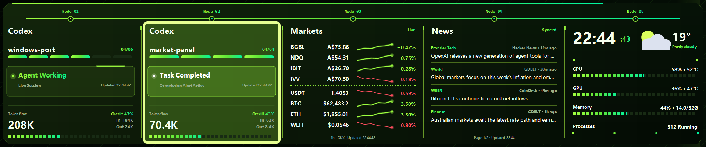\
**Graphite Titanium**\
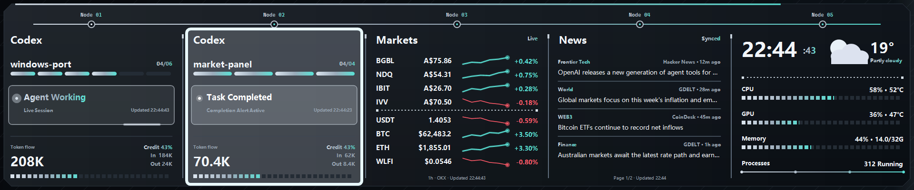\
**Cyber Neon**\
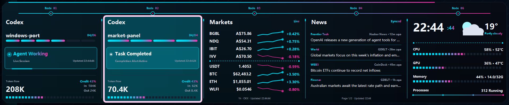\
**Solana Aurora**\
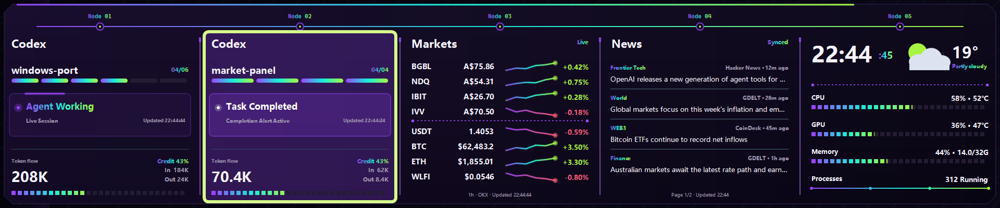

Each state is shown in all five included themes. Switch at any time from
**Settings → Color Theme**, then choose **Save Settings**. The selected palette applies to the LCD,
local preview, animated agent states, market charts, quota graphics, and desktop completion alerts,
and is restored on the next launch.

## Features

- Prioritizes recent Codex, Cursor, and Claude Code sessions in the first four columns, with both workspace and real chat titles;
- Uses three agent states—`Agent Working`, `Task Completed`, and `Waiting for You`—with an animated working border and persistent completion acknowledgement cards;
- Fills unused columns with MARKETS, NEWS, AI QUOTA, and a future-weather FORECAST panel;
- Keeps time, weather, CPU, GPU, memory, and process data in the fixed last column;
- Tracks BGBL.AX, NDQ.AX, IBIT.AX, IVV.AX, USDT/AUD, BTC, ETH, and WLFI;
- Uses GDELT, Hacker News, and CoinDesk for English news, and Open-Meteo for weather;
- Includes five structure-preserving color themes: Bitcoin Orange, Web3 Emerald, Graphite
  Titanium, Cyber Neon, and Solana Aurora. The selected palette also applies to completion alerts;
- Supports the Trofeo Vision 11.3 1920×400 LY USB protocol;
- Includes tray operation, launch at login, single-instance protection, USB reconnection,
  preview, and 180° rotation;
- Ships with its runtime and USB dependency, so users do not need a separate .NET installation.

## Dashboard layout

The display has four dynamic columns and one fixed column. Active AI sessions take priority; the remaining dynamic columns are filled as follows:

| Active AI sessions | Columns 1–4 | Fixed last column |
|---:|---|---|
| 4 or more | Agent × 4 | Time, current weather, CPU, GPU, Memory, Processes |
| 3 | Agent × 3, Markets | Same |
| 2 | Agent × 2, Markets, News | Same |
| 1 | Agent, Markets, News, AI Quota | Same |
| 0 | Markets, News, AI Quota, Forecast | Same |

`Forecast` contains only upcoming conditions, while the fixed column shows current weather, so the two panels do not duplicate one another. Agent panels show the workspace/repository, real chat title, state, and available token/plan progress without displaying conversation text.

The state lifecycle is `Agent Working` → `Task Completed` → `Waiting for You` after acknowledgement. If the same session resumes before acknowledgement, the stale completion alert is cleared automatically and the panel immediately returns to `Agent Working`. A session leaves the dynamic area 10 minutes after its last activity; an unacknowledged completion remains visible only while that session has not resumed.

## Requirements

- Windows 10 version 1809 or newer; Windows 11 is recommended;
- Thermalright Trofeo Vision 11.3 LCD with USB ID `0416:5408`;
- WinUSB or libusbK driver for the LCD;
- Exit the official TRCC application before using this program because only one process
  can access the USB device at a time.

## Download and run

Download the ZIP matching your architecture from GitHub Releases. Most PCs use `win-x64`.
Extract the complete folder and run:

```text
NJC AI Monitor.exe
```

The application stays in the system tray. Double-click its tray icon to open the preview,
or right-click it for settings, USB diagnostics, and exit controls.
Choose a color theme in **Settings → Color theme**; the saved theme is applied to the next
LCD and preview frame and remains selected after restart.
If Windows SmartScreen blocks the first launch, verify the download source and choose
**More info → Run anyway**. Community release binaries are currently unsigned.

## Build from source

Install the [.NET 8 SDK](https://dotnet.microsoft.com/download/dotnet/8.0), then run from
the repository root:

```powershell
.\Windows\build.ps1
```

To create a distributable ZIP:

```powershell
.\Windows\package.ps1 -Runtime win-x64
```

Output is written to `Windows\dist`. See the [detailed Windows guide](Windows/README.md)
for data sources, command-line modes, and troubleshooting.

## Repository layout

```text
.github/workflows/                  GitHub builds and releases
Windows/
├─ NjcAI.Monitor.sln            Visual Studio / Rider solution
├─ build.ps1                        Build script
├─ package.ps1                      Release packaging script
├─ README.md                        Detailed documentation
├─ THIRD_PARTY_NOTICES.md           Third-party notices
└─ src/NjcAI.Monitor/
   ├─ Program.cs                    Application entry point
   ├─ AppController.cs              Refresh, tray, and USB orchestration
   ├─ Core/                         Settings, models, and logging
   ├─ Services/                     Agent, market, news, weather, and hardware collectors
   ├─ Rendering/                    1920×400 dashboard renderer
   ├─ UI/                           Preview and settings windows
   ├─ Usb/                          LY protocol and LCD communication
   ├─ Assets/                       Application icon
   └─ Native/                       x64/ARM64 libusb binaries
```

## Privacy

Agent information is read only from local session logs under the current Windows user.
The application does not upload conversations or read Codex login tokens. Market, news,
and weather panels send only symbols or weather coordinates to their public data services.

## Third-party components

See [THIRD_PARTY_NOTICES.md](Windows/THIRD_PARTY_NOTICES.md) for library licenses and notices.

## Origin and acknowledgements

NJC AI Monitor is an independent Windows/C# rewrite based primarily on
[beret21/MacTR](https://github.com/beret21/MacTR). Early AI-agent monitoring concepts were
inspired by the `m1ng-li/mac-thermalright-ai-monitor` community fork, which is no longer used as
this project's release remote or product identity. See [NOTICE.md](NOTICE.md) for details.

## Contributing and license

See [ARCHITECTURE.md](docs/ARCHITECTURE.md) for the code map and
[CONTRIBUTING.md](CONTRIBUTING.md) before submitting changes. The project is available under the
[MIT License](LICENSE).
