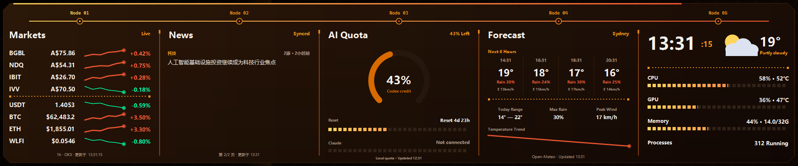
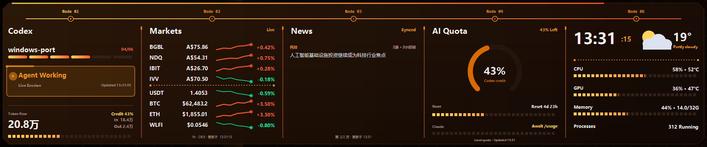
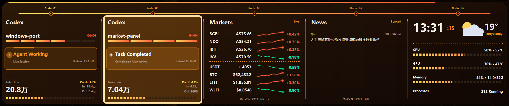

# NJC AI Monitor

[English](README.md) · **简体中文**

面向 Windows 10/11 和利民 Trofeo Vision 11.3 LCD 的 AI Agent 桌面监控程序。
程序会把 Codex、Cursor、Claude Code、本机内存、股票/加密货币行情、新闻和天气
渲染为 1920×400 五栏仪表盘，并通过 USB 发送到 LCD；没有连接屏幕时也可以使用本机预览。

## 界面预览

### 1. 没有活跃 Agent

四个动态栏显示 Markets、News、AI Quota 和 Forecast，最右栏保持系统与当前天气信息。



### 2. 一个 Agent 正在工作

工作中的 Agent 占据第一栏，其余栏位依次由 Markets、News 和 AI Quota 补齐。



### 3. 两个 Agent：工作中与刚完成

第一栏展示 `Agent Working`，第二栏展示带持续提醒边框的 `Task Completed`，其余两栏为 Markets 和 News。



## 主要功能

- 左侧四栏优先显示最近活跃的 Codex、Cursor 和 Claude Code 会话，并同时显示工作区与真实聊天标题；
- Agent 状态统一为 `Agent Working`、`Task Completed` 和 `Waiting for You`；工作状态使用动态边框，完成提醒持续闪烁并显示不会自动消失的桌面确认卡片；
- AI 会话不足时，依次使用 MARKETS、NEWS、AI QUOTA 和未来天气 FORECAST 补位；
- 最右一栏固定整合时间、天气、CPU、GPU、内存和进程数；
- 支持 BGBL.AX、NDQ.AX、IBIT.AX、IVV.AX、USDT/AUD、BTC、ETH 和 WLFI 行情；
- 使用 TextRadar 新闻和 Open-Meteo 天气；
- 内置 Bitcoin Orange、Web3 Emerald、Deep Ocean、Royal Indigo 和 Cyber Neon 五套同构配色主题，
  所选主题也会同步应用到任务完成提醒；
- 支持 Trofeo Vision 11.3 的 1920×400 LY USB 协议；
- 支持托盘运行、登录自启、单实例保护、USB 热插拔、本机预览和 180° 旋转；
- 发布包自带程序运行环境和 USB 依赖，不要求用户另外安装 .NET。

## 屏幕布局

屏幕由四个动态栏和一个固定栏组成。动态栏优先保留最近活跃的 AI 会话，不足时按顺序补入信息面板：

| 活跃 AI 会话 | 左一至左四 | 最右固定栏 |
|---:|---|---|
| 4 个或更多 | Agent × 4 | 时间、当前天气、CPU、GPU、Memory、Processes |
| 3 个 | Agent × 3、Markets | 同左 |
| 2 个 | Agent × 2、Markets、News | 同左 |
| 1 个 | Agent、Markets、News、AI Quota | 同左 |
| 0 个 | Markets、News、AI Quota、Forecast | 同左 |

`Forecast` 只显示未来数小时的预报，最右固定栏显示当前天气，因此两者不会重复。Agent 面板显示工作区/仓库名称、真实聊天标题、状态、Token/计划进度；不在小屏幕上展示对话正文。

Agent 状态按以下方式转换：`Agent Working` → `Task Completed` → 确认提醒后 `Waiting for You`。如果未确认提醒便直接继续同一会话，旧提醒会自动清除并立即回到 `Agent Working`。会话最后活动超过 10 分钟后退出动态栏；没有继续对话时，未确认的完成提醒会一直保留。

## 运行要求

- Windows 10 1809 或更新版本，推荐 Windows 11；
- 利民 Trofeo Vision 11.3 LCD，USB ID `0416:5408`；
- LCD 使用 WinUSB 或 libusbK 驱动；
- 使用本程序前退出官方 TRCC，同一时间只能有一个程序占用设备。

## 下载和使用

从 GitHub Releases 下载与你电脑架构匹配的 ZIP。绝大多数电脑应选择 `win-x64`。
解压完整文件夹后，双击：

```text
NJC AI Monitor.exe
```

程序会驻留系统托盘。双击托盘图标打开预览，右键托盘图标可以打开设置、USB 诊断或退出程序。
在“设置 → 颜色主题”中选择配色并保存，下一帧 LCD 与本机预览会立即更新，重启后仍会保留。
首次运行若被 Windows SmartScreen 拦截，请在确认下载来源后选择“更多信息”→“仍要运行”。当前社区发布包未进行代码签名。

## 从源码构建

需要安装 [.NET 8 SDK](https://dotnet.microsoft.com/download/dotnet/8.0)。在仓库根目录运行：

```powershell
.\Windows\build.ps1
```

生成可发布 ZIP：

```powershell
.\Windows\package.ps1 -Runtime win-x64
```

输出位于 `Windows\dist`。完整的运行、数据来源、命令行和故障排查说明见
[Windows 使用与构建文档](Windows/README.md)。

## 项目结构

```text
.github/workflows/                  GitHub 自动构建和发布
Windows/
├─ NjcAI.Monitor.sln            Visual Studio / Rider 解决方案
├─ build.ps1                        编译脚本
├─ package.ps1                      发布 ZIP 打包脚本
├─ README.md                        详细说明
├─ THIRD_PARTY_NOTICES.md           第三方组件声明
└─ src/NjcAI.Monitor/
   ├─ Program.cs                    程序入口
   ├─ AppController.cs              刷新、托盘和 USB 总控制器
   ├─ Core/                         设置、模型和日志
   ├─ Services/                     Agent、行情、新闻、天气和硬件采集
   ├─ Rendering/                    1920×400 仪表盘渲染
   ├─ UI/                           预览和设置窗口
   ├─ Usb/                          LY 协议与 LCD 通信
   ├─ Assets/                       应用图标
   └─ Native/                       x64/ARM64 libusb
```

## 隐私

AI Agent 信息只从当前 Windows 用户目录中的本地会话日志读取。程序不会上传对话内容，
也不会读取 Codex 登录令牌。行情、新闻和天气功能只会向对应的公开数据服务发送标的代码或天气坐标。

## 第三方组件

第三方库及其许可证见 [THIRD_PARTY_NOTICES.md](Windows/THIRD_PARTY_NOTICES.md)。

## 来源与致谢

NJC AI Monitor 是以 [beret21/MacTR](https://github.com/beret21/MacTR) 为主要上游完成的
独立 Windows/C# 重写。早期 AI Agent 监控概念参考过 `m1ng-li/mac-thermalright-ai-monitor`
社区分支；它不再作为本项目的发布仓库或产品身份。完整说明见 [NOTICE.md](NOTICE.md)。

## 参与开发与许可证

架构说明见 [ARCHITECTURE.md](docs/ARCHITECTURE.md)，提交代码前请阅读
[CONTRIBUTING.md](CONTRIBUTING.md)。本项目采用 [MIT License](LICENSE)。
